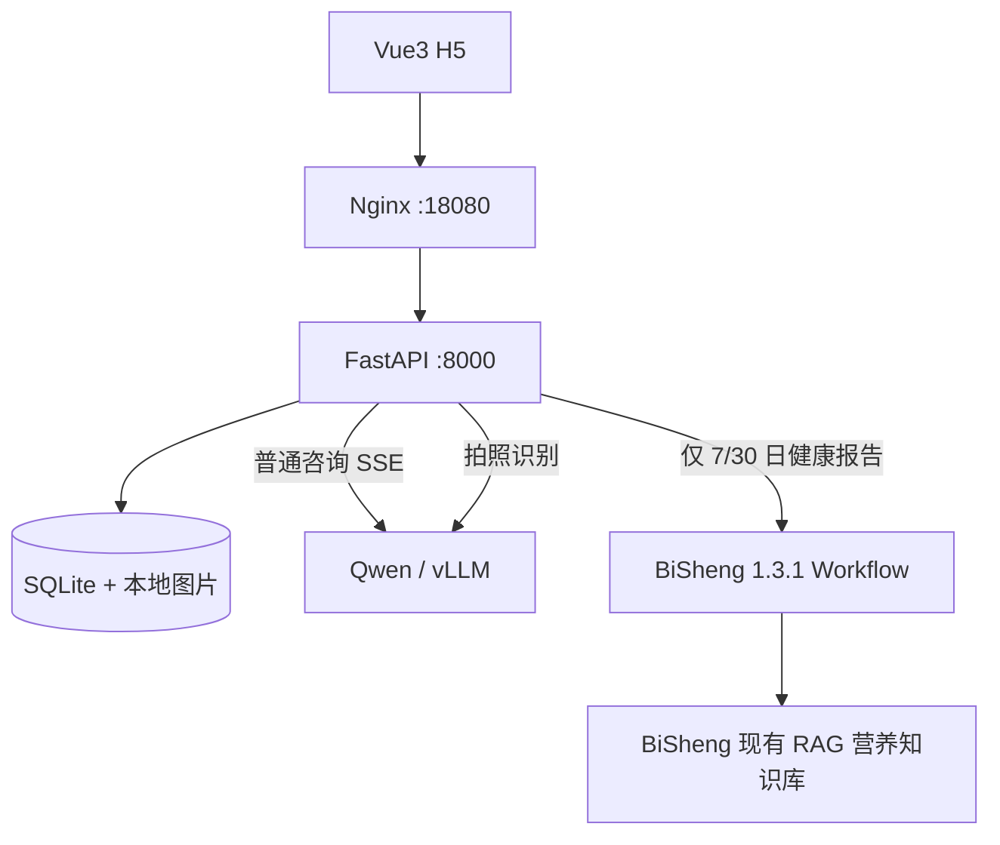

# 食光 · AI 营养师 H5

> 面向普通成年人健康管理的轻量 MVP。**Python FastAPI + Vue3 H5 + MySQL / SQLite + Nginx + Qwen 多模态**。目标最多同时处理 **10 个在途 AI 请求**，单 Uvicorn Worker 限制；上线前需压测 GPU 推理容量。

172.16.10.3 的实际部署使用已有 MySQL 5.7、新建的 `ai_nutritionist_h5` 数据库及 `Qwen3.8-27B`。本次报告功能暂不启用。配置位置、运维命令和部署说明见 [服务器部署说明](docs/DEPLOYMENT_172.16.10.3.md)。以下 SQLite / BiSheng 内容保留为其他部署模式的参考。

## 业务分流



- **首页**：今日摄入汇总、拍照、营养咨询和报告入口。
- **拍照**：上传 JPG/PNG/WebP → 多模态识别候选食物 → 人工选择标准食物/重量 → SQLite 成分表计算 → 保存。
- **AI 咨询**：FastAPI 直接调用 vLLM `/v1/chat/completions` SSE，携带用户档案及最近 12 条会话消息，**不经过 BiSheng**。
- **饮食记录**：每日三餐记录和统计；按 `Asia/Shanghai` 日期聚合。
- **报告**：FastAPI 汇总近 7/30 日数据 → `BiSheng 1.3.1 /api/v2/workflow/invoke` → 保存报告文本和统计快照 → H5 展示历史。
- **我的**：注册/登录、个人档案、目标。会话 Cookie 为 HttpOnly，同一用户数据隔离。

演示模式使用固定餐食识别/文字回复，只用于验证前后端联动；食物成分表的 10 条初始条目均为演示数据，正式发布前需替换为有授权、含来源和烹调状态的成分数据。

## 一、目标服务器一键安装（172.16.10.3）

### 必要条件

Ubuntu/Linux，已安装 Docker Engine 与 `docker compose` v2；服务器能够拉取 `python:3.11-slim`、`node:22-alpine`、`nginx:stable-alpine`，并能从 npm/PyPI 下载依赖。已有的 BiSheng 和 vLLM **不属于本 Compose**，不会修改已有服务或占用其原端口。确保 TCP 端口 `18080` 未被占用，目标目录为 `/data_1/ai-nutritionist-h5`。

将这个项目 ZIP 解压到服务器任意目录（例如 `/tmp/ai-nutritionist-h5`）。你也可以在本地 Mac/Linux 电脑通过 SSH 上传并初始化：

```bash
bash deploy/push-to-server.sh <你的SSH用户名> 172.16.10.3
```

如果代码已经解压在服务器，直接执行：

```bash
cd /tmp/ai-nutritionist-h5
sudo bash deploy/install.sh
```

**第一次执行：** 自动创建 `/data_1/ai-nutritionist-h5/`、`data/media/`，复制项目及 `.env` 模板，然后暂停，等待配置你现有服务的地址和密钥。**不会覆盖已有 `.env` 和 SQLite 数据**。

随后编辑服务器配置：

```bash
sudo nano /data_1/ai-nutritionist-h5/.env
```

至少设置：

```dotenv
DEMO_MODE=false
APP_BIND_IP=172.16.10.3
APP_PORT=18080
APP_ALLOWED_ORIGIN=http://172.16.10.3:18080
APP_COOKIE_SECURE=false
APP_MAX_AI_CONCURRENCY=10
VLLM_CHAT_COMPLETIONS_URL=http://<模型可访问主机>:8000/v1/chat/completions
VLLM_MODEL=<你的 vLLM --served-model-name>
VLLM_API_KEY=<模型网关密钥，可留空>
VLLM_VISION_URL=http://<视觉模型可访问主机>:8000/v1/chat/completions
VLLM_VISION_MODEL=<视觉模型 served-model-name>
BISHENG_REPORT_URL=http://<毕昇可访问主机>:7860/api/v2/workflow/invoke
BISHENG_REPORT_WORKFLOW_ID=<已发布的UUID>
```

注意：配置时将尖括号占位符替换成真实值，不要把尖括号保留在 `.env` 中。如果文字与视觉模型是同一个 vLLM 实例，可留空 `VLLM_VISION_URL` 和 `VLLM_VISION_MODEL`。Docker 容器里 `127.0.0.1` 指容器自身，**不能填宿主机监听 127.0.0.1 的接口**。可以使用服务器 LAN IP 或 `host.docker.internal`（项目添加了 `host-gateway`，但宿主机服务必须监听对 Docker 可达的接口）。

第二次执行：

```bash
sudo bash /data_1/ai-nutritionist-h5/deploy/install.sh
# 打开 http://172.16.10.3:18080
```

检查状态与日志：

```bash
cd /data_1/ai-nutritionist-h5
sudo docker compose ps
sudo docker compose logs -f --tail=100 api web
curl -I http://172.16.10.3:18080/
curl http://172.16.10.3:18080/api/health
```

如果服务器端口或网卡绑定不同，修改 `APP_BIND_IP`、`APP_PORT` 及 `APP_ALLOWED_ORIGIN`，再执行安装脚本。**Nginx 容器处理静态 H5 / 受保护的图片，FastAPI 不向公网暴露独立端口。**

### 本地持久化

```text
/data_1/ai-nutritionist-h5/
├── .env                  # 密钥，600 权限，不提交 Git
├── docker-compose.yml
├── frontend/ backend/ deploy/ docs/
└── data/
    ├── nutrition.db       # SQLite (WAL)
    ├── nutrition.db-wal
    ├── nutrition.db-shm
    └── media/             # 图片，经 FastAPI 鉴权后 Nginx X-Accel-Redirect 读取
```

不要直接把 `/data_1/ai-nutritionist-h5/data/media` 配成可公开访问的静态路径。数据需要定期备份、清理，迁移前务必备份 DB 与上传文件。**现阶段使用 HTTP + APP_COOKIE_SECURE=false 仅适用于可信内网测试**；公网必须上 HTTPS，启用 `APP_COOKIE_SECURE=true` 并做账号防暴力破解和安全评估。

## 二、API

| 接口 | 说明 |
|---|---|
| `POST /api/auth/register`、`/login` | 注册 / 登录 |
| `GET/PUT /api/profile` | 个人档案 |
| `POST /api/images`、`GET /api/images/{id}` | 上传、鉴权后查看图片 |
| `POST /api/meals/recognize` | Qwen 多模态食物识别 |
| `GET /api/foods` | 标准食物成分表 |
| `POST /api/meals`、`GET /api/meals` | 保存与查询饮食记录 |
| `GET /api/nutrition/summary?days=7` | 日期聚合（Asia/Shanghai） |
| `POST /api/chat/stream` | **Qwen SSE** 营养咨询 |
| `GET /api/chat/history?thread_id=...` | 当前用户聊天历史 |
| `POST /api/reports/generate?days=7` | **BiSheng Workflow** 健康报告 |
| `GET /api/reports`、`GET /api/reports/{id}` | 历史报告、报告详情 |

## 三、BiSheng 工作流

详细协议/输入节点/输出节点说明见 [`docs/BISHENG_WORKFLOW.md`](docs/BISHENG_WORKFLOW.md)。1.3.1 官方开放接口 `POST /api/v2/workflow/invoke` 支持 `stream=false` 返回 `data.events`。如使用 Input 节点，服务端会先产生 `input` 事件，应用需要带同一个 `session_id` 二次发送 `input`；已按该行为编写适配器并用模拟响应做测试。

由于尚未获得你部署的具体工作流 UUID、输入 Key 和返回数据，**不能把“适配器通过模拟测试”当成“真实 BiSheng 已联调”**。需要用你的真实服务进行验收。

## 四、测试与本地开发

```bash
cd backend
python -m pip install -r requirements.lock.txt
PYTHONPATH=. pytest -q
```

前端：

```bash
cd frontend
npm ci
npm run build
```

纯本地开发 `DEMO_MODE=true` 且 `APP_COOKIE_SECURE=false`；Vite 通过 `/api` 转发给本地 FastAPI。服务器部署则使用两容器构建，不需要宿主机手动安装 Node 或 Python 依赖。

## 五、工程边界

- 单 Python Worker + 10 个 AI 并发槽，适合 MVP 测试。并发超过目标返回 429，不保证模型本身支持同等 GPU 吞吐。
- 私有 IP `172.16.10.3` 不可从互联网直接访问，且没有 SSH 授权时，交付的部署脚本不会自动远程执行。
- BiSheng 1.3.1 属于较早版本，请保留在可信内网并评估升级与安全补丁，不直接对公网开放 v2 Workflow API。
- 当前报告是**网页可阅读的文字分析**，未生成 Word/PDF；后续如有需要可增加导出。
- 服务器已完成构建与核心功能验收，记录见 [服务器部署记录](docs/DEPLOYMENT_172.16.10.3.md)；GPU 并发压测尚未进行。

## 六、自动交付

PR 构建测试、合并后部署、自动验收与回滚见 [AI Native 交付说明](docs/AI_NATIVE_DELIVERY.md)。食品库生成与数据来源见 [食品库说明](docs/FOOD_CATALOG.md)。
