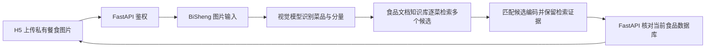

# BiSheng 餐食图片识别与食品知识库

餐食识别和健康报告使用独立工作流与配置。启用本功能不会启用健康报告，普通营养咨询仍直接调用现有模型。

## 数据与流程



知识库只含食品成分表，不导出账号、饮食记录、健康档案或用户图片。每条食品独立分块，正文可直接阅读名称、别名、做法、每 100 克营养、来源、模型和批次。原始记录、目录快照、记录及正文校验值保存在文档元数据；不再包装为问题/答案。模型生成的数据始终保留 `source_type=ai_estimate`、`verified=0`，不能作为实验核验数据。

工作流最多识别 8 项食物，分量范围为 5～3000 克。检索相关度仅用于召回；模型不能编造食品编码。服务端还会按当前数据库复核名称、别名、生熟及烹调状态。存在歧义、做法冲突或候选已失效时留空，让用户选择。旧演示数据名称中的“（熟）”仅可用作通用熟食参考，不修改其来源或原有数据。

H5 通过数据库食品编码回显名称、做法和每 100 克热量，按 `数据库 kcal × 重量 / 100` 计算。保存时后端再次读取数据库计算，不采用模型输出的热量。

## 已部署资源

| 资源 | 值 |
|---|---|
| BiSheng 管理平台 | `https://172.16.10.4:3001/build/apps` |
| 食品文档知识库 | `食光食品文档库-数据库快照`，ID `201`，类型 `0` |
| 食品数量 | 2054 条，21 个 TXT 文件，每条食品一个分块 |
| 历史 QA 库 | ID `200`，保留用于历史版本回退，新工作流不使用 |
| 图片工作流 | `食光餐食识别与食品热量检索` |
| 工作流 ID | `7494d578a3a34513a31a84ebdeb80335` |
| 视觉及匹配模型 | 现有 `Qwen3.8-27B`，模型 ID `43` |
| 向量模型 | 现有 `Qwen3-Embedding-8B`，模型 ID `31` |

这些标识不含密钥。重新部署时复用已有资源，避免重复建库或重复导入。

## 服务端配置

配置保存在服务器 `/data_1/ai-nutritionist-h5/.env`，权限为 600，不提交 Git：

```dotenv
FOOD_RECOGNITION_PROVIDER=bisheng
BISHENG_RECOGNITION_BASE_URL=http://172.16.10.4:7860
BISHENG_RECOGNITION_WORKFLOW_ID=7494d578a3a34513a31a84ebdeb80335
BISHENG_RECOGNITION_API_KEY=
BISHENG_RECOGNITION_INPUT_FIELD=input
BISHENG_RECOGNITION_IMAGE_KEY=meal_image
BISHENG_RECOGNITION_TIMEOUT=240
```

内置开放接口通过平台的默认操作人执行。仅在前面配置了鉴权网关时填写 API Key，不把管理员登录会话写入应用配置。API 容器必须能访问 BiSheng 7860 端口。图片会传至该内网 BiSheng 服务，应按其上传文件保留策略管理。

调用先获取 `input` 事件，再用同一 `session_id`、`message_id` 和嵌套输入 `{input_meal: {meal_image: [上传返回路径]}}` 继续。此实例实测外层字段为 `input`；部分 OpenAPI 展示的 Python 字段名 `user_input` 不适用于该实例。配置错误或工作流失败返回明确错误，不静默切回直接模型识别。

## 更新知识库与工作流

在 API 的运行环境执行只读导出，输出目录须在 Git 忽略范围内：

```bash
python -m app.knowledge_export --output /data/export/food-knowledge
```

导出生成 `food_documents.jsonl`、`food_catalog.txt`、`bisheng_document_batches.json` 和 `manifest.json`，另保留兼容旧版本的 `qa_records.jsonl`。新建**文档知识库**（`type=0`），使用现有向量模型。逐批将 `bisheng_document_batches.json` 的 `documents` 原样发送至 `POST /api/v2/filelib/chunks_string`，附 `knowledge_id`；一个批次对应一个可查看的 TXT 文件。该 v1.3.1 接口按每个 Document 切分，生成器会拒绝超过 1000 字符或含双换行的正文，避免分块与元数据错位。

逐批确认文件状态为 `2`，再核对分块总数、每个食品编码唯一、原始记录和正文摘要均与导出一致。为避免重复索引，只导入尚不存在的文件名；失败批次应先查明已写入状态，不能盲目重试。先完成新快照索引和验收，再发布新工作流版本；旧库及旧版本保留用于回退。

`deploy/bisheng_food_workflow.py` 根据知识库、模型与快照标识生成原生工作流定义，不连接服务器、不自动创建资源：

```bash
python deploy/bisheng_food_workflow.py --help
```

在画布打开“检索食品文档库（前8候选）”节点，可查看输入参数 `knowledge_id`、`score_threshold`、`top_k` 及识别食物变量。节点按“菜名，做法”调用 BiSheng 文档向量检索，逐菜召回最多 8 个真实分块；当前阈值 `0.1`，根据该文档库的米饭、宫保鸡丁、酸奶、紫薯和不存在食品查询校准，分数不是概率。它明确拒绝 QA 库，并校验库编号、文件及分块标识、正文摘要、记录摘要和快照。未识别到食物时不检索空查询。

使用代码节点是因为 v1.3.1 内置“文档知识库问答”节点只向下游输出模型生成的答案，真实来源文档只留在运行日志，无法作为下游编码校验的确定证据。这里直接检索同一文档向量库，再由匹配模型从真实候选中选择编码。该实现依赖 BiSheng v1.3.1 接口，升级平台前需重新验证；不是内置问答节点。

原始食品文档和记录保留在知识库及工作流证据步骤。最终接口只返回食物身份、候选编码和证据摘要（库、文件、分块和校验值），避免将完整食品记录重复写入 BiSheng 的 `chatmessage.message` 文本字段；应用从当前数据库读取营养与来源。生成器测试覆盖整餐 8 项、每项 8 候选的输出容量。

## 验收与限制

验收应覆盖真实餐食图片、无食物图片、服务异常，以及食品编码回显、重量调整后的热量变化。还须登录 BiSheng 实际打开工作流画布，检查全部节点和变量选择器；仅通过执行 API 不代表编辑器兼容。生成器需保留编辑器要求的 `output_form.options`、温度范围和输出变量声明，避免出现 `undefined.map`。数据库测试必须使用独立的 `test_` 数据库。只有合并提交的 `ci.yml` 通过后才允许部署；部署验收失败恢复上一版镜像。

图片无法可靠判断配方、用油和实际重量；未匹配的项目需要手工确认。食品库主要为未核验的 AI 估算，索引完整不代表营养值经过实验验证。数据库后续修改不会自动同步到 BiSheng，需按上述流程重新导出并验收。
