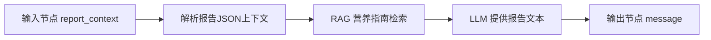

# BiSheng v1.3.1 健康报告工作流接入

本文说明可选的 7/30 日健康报告工作流，当前服务器仍未启用报告。餐食图片的独立 BiSheng 工作流见 [餐食识别接入说明](BISHENG_FOOD_RECOGNITION.md)。普通聊天直接请求 vLLM/Qwen；用户健康档案与饮食记录保存在应用数据库，不上传食品知识库。

## 已核对的官方源码（固定 v1.3.1）

- [`api/v2/workflow.py`](https://github.com/dataelement/bisheng/blob/v1.3.1/src/backend/bisheng/api/v2/workflow.py) 定义 `POST /api/v2/workflow/invoke`；字段 `workflow_id: UUID`、`stream: bool`、`input: dict`、`session_id: str`、`message_id: int`。
- [`api/v1/schema/workflow.py`](https://github.com/dataelement/bisheng/blob/v1.3.1/src/backend/bisheng/api/v1/schema/workflow.py) 定义返回的 `data.events[]`：`input`、`output_msg`、`stream_msg`、`close`、`error` 等。
- `stream=false` 时返回 `data.session_id` 和 `data.events`；Input 节点需要按同一 `session_id` 第二次调用，附带 `input` 字段。默认访问账号 `default_operator.user` 要在 BiSheng 配置中正确设置。
- `stream=true` 以 SSE 返回 `WorkflowStream`，目前项目使用 **非流式模式** 等待报告结束，便于保存完整报告。

## 在 BiSheng 中创建的工作流



1. 新建并发布“AI 营养健康报告”工作流，复制工作流 UUID。
2. 输入节点使用 **对话文本或表单文本**，字段 Key 推荐 `report_context`。本项目会按照工作流返回的 `input_schema.value[].key` 填充字段；支持 `report_context`、`summary`、`nutrition_summary`、`profile`、`period_days` 等。未识别的文本字段默认传完整 JSON。
3. 在 LLM 提示词中解析 `report_context` 中的 `nutrition_summary`、`profile`、`period_days`。分析饮食记录是否完整，指出营养摄入趋势，给出一般饮食建议；参考 RAG 返回的营养指南，并要求输出文本，不编造营养数值。
4. **必须接输出节点，输出文字报告**。本版保存 Markdown/纯文本到 SQLite，并在 H5 展示。不要求工作流生成 DOCX、PDF，也不会自动下载 BiSheng 产生的文件 URL。
5. 在服务器 `.env` 设置：

```dotenv
BISHENG_REPORT_URL=http://<可从api容器访问的BiSheng主机>:7860/api/v2/workflow/invoke
BISHENG_REPORT_WORKFLOW_ID=xxxxxxxx-xxxx-xxxx-xxxx-xxxxxxxxxxxx
BISHENG_REPORT_API_KEY=
BISHENG_REPORT_INPUT_KEY=report_context
```

> BiSheng 1.3.1 的 v2 open API 原生走默认操作人，而非必然要求 Bearer API Key。只在你有自定义鉴权网关时设置 `BISHENG_REPORT_API_KEY`。千万不要把这个接口直接暴露互联网。

## Python 侧工作流处理

`backend/app/reporting.py`：先 `{"workflow_id":"...","stream":false}`，收到 `input` 事件及 `session_id` 后，将 FastAPI 已计算好的报告 JSON 作为对应 `input` 字段二次提交；最后从 `output_msg.output_schema.message` 获取文字并保存。如果中途发生错误，API 返回 502，不生成伪造报告。

主要输入 JSON 格式（示意）：

```json
{
  "period_days": 7,
  "nutrition_summary": {
    "days": 7,
    "recorded_days": 5,
    "totals": {"kcal": 7000, "protein": 240, "fat": 170, "carbs": 990},
    "daily": []
  },
  "profile": {"age": 30, "height_cm": 175, "weight_kg": 70, "goal": "balanced"},
  "instructions": "请基于实际记录生成一般营养健康分析"
}
```

此示意数据不是实际用户记录。食物成分值以本项目数据库计算的结果为准。

## 联调验收

先用 BiSheng 自带的“API 发布/调试”复制真正的工作流 UUID，确认具有输入节点与文字输出节点，能够执行无记录、记录不全和正常记录三种测试。再配置 `.env` 并启动，调用 `POST /api/reports/generate?days=7`，检查 `source=bisheng-1.3.1`，以及数据库中生成了可查看的报告。出现 502 时先检查 `docker compose logs -f api`，重点排查 Input Key、工作流权限和 output schema。

**注意**：这是按 1.3.1 官方源码实现的协议适配，已用模拟事件做单元测试；尚未获得你服务器真实工作流 ID、输入节点配置及返回报文，无法声称已真实联通。
